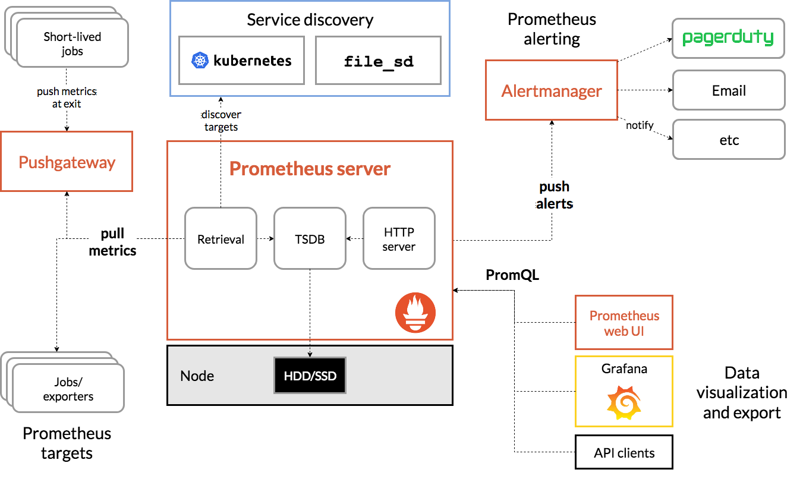
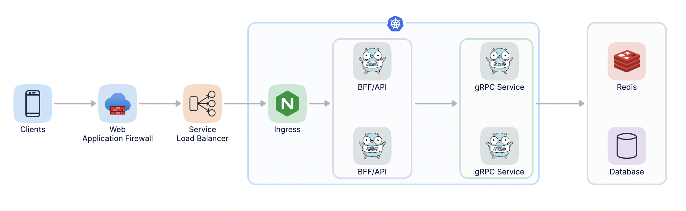
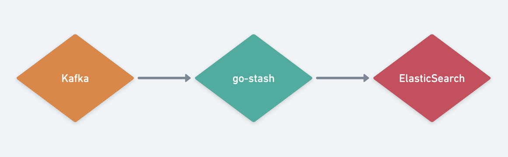

# mixbench-backend

## 设计原则

1. 领域驱动设计（Domain-Driven Design）：将系统按照业务领域进行划分。每个微服务负责一个明确的业务领域，尽可能保持高内聚和低耦合。

2. 单一职责原则（Single Responsibility Principle）：每个微服务应该只关注一个特定的业务功能或者业务过程，功能越单一越好。

3. 服务自治（Service Autonomy）：微服务应该具有一定的自治性，能够独立运行、部署和扩展。每个微服务应该有自己的数据存储、业务逻辑和用户界面。

4. 服务边界（Service Boundaries）：根据业务需求和功能划分，避免服务之间的功能重叠和交叉。

5. 通信与协作（Communication and Collaboration）：微服务之间通过轻量级的通信机制进行交互，例如使用RESTful API、消息队列等。

6. 可组合性（Composability）：微服务应该具备自由组合的能力，即可以按需组合成更复杂的系统。

7. 高可用性和容错性（High Availability and Fault Tolerance）：每个微服务都应该被设计成可独立水平扩展，并且具备容错和自恢复能力。

## 当前微服务的设计

1. admin 服务提供账号管理服务，通过该服务来处理账号相关的逻辑有助于保持一致性和可维护性;
2. auth 服务提供鉴权与验证码服务，将身份验证和鉴权逻辑与账号管理逻辑分离开来，提高系统的安全性和模块化程度;
3. 拓展服务，这些业务服务可以建立在现有的账号管理和鉴权基础之上。

## 系统结构组成

| 类别     | 服务名称           | 暴露端口 | 映射端口    | 说明                                             |
| -------- | ------------------ | -------- | ----------- | ------------------------------------------------ |
| 数据库   | mysql              | 3306     | -           | mysql数据库                                      |
| 数据库   | mysqlmanage        | 80       | -           | mysql管理面板 (ui)                               |
| 缓存库   | redis              | 6379     | -           | redis缓存库                                      |
| 缓存库   | redismanage        | 80       | -           | redis管理面板(ui)                                |
| 公网网关 | nginx              | 80,443   | -           | nginx正向代理服务                                |
| 内网网关 | nginx              | 80,443   | 11080,11443 | nginx反向代理服务                                |
| 数据中心 | datacenter         | -        | -           | 数据卷容器，存储各个服务生产的数据(目前暂时弃用) |
| 文件管理 | filebrowser        | 80       | -           | 文件管理服务，用于浏览数据中心文件(ui)           |
| 链路追踪 | jaeger             | 6831/udp | -           | 接受jaeger.thriftThrift-compact 协议             |
| 链路追踪 | jaeger             | 6832/udp | -           | 接受jaeger.thriftThrift-binary 协议              |
| 链路追踪 | jaeger             | 5778     | -           | 服务配置（采样等）                               |
| 链路追踪 | jaeger             | 16686    | -           | 服务前端 (ui)                                    |
| 链路追踪 | jaeger             | 14268    | -           | 直接从客户端接受jaeger.thrift协议                |
| 链路追踪 | jaeger             | 9411     | -           | 兼容 Zipkin 服务（可选）                         |
| 服务监控 | prometheus         | 9090     | -           | 服务监控系统                                     |
| 服务监控 | grafana            | 3000     | -           | prometheus服务监控系统 (ui)                      |
| 数据收集 | elasticsearch      | 9200     | -           | http协议连接es使用的端口                         |
| 数据收集 | elasticsearch      | 9300     | -           | tcp客户端连接使用的端口                          |
| 数据收集 | kibana             | 5601     | -           | 查看elasticsearch数据 (ui)                       |
| 日志收集 | filebeat           | -        | -           | 收集日志并上报到kafka                            |
| 日志处理 | go-stash           | -        | -           | 处理kafka中的日志并发送到es                      |
| 消息队列 | zookeeper          | 2181     | -           | kafka的依赖服务                                  |
| 消息队列 | kafka              | 9092     | -           | kafka消息队列                                    |
| 消息队列 | CMAK               | 9000     | -           | 用于管理Apache Kafka集群的工具 (ui)              |
| 消息队列 | asynqmon           | 8080     | -           | go基于redis实现的消息队列及面板 (ui)             |
| 核心服务 | app                | -        | -           | modd热编译环境                                   |
| 核心业务 | admin-api          | 7011     | -           | 管理员API服务                                    |
| 核心业务 | admin-rpc          | 7012     | -           | 管理员RPC服务                                    |
| 核心业务 | authentication-api | 7021     | -           | 鉴权API服务                                      |
| 核心业务 | authentication-rpc | 7022     | -           | 鉴权RPC服务                                      |
| 核心业务 | authentication-mq  | 7023     | -           | 鉴权MQ服务(asynq) DB=2                           |
| 核心业务 | luckydraw-api      | 7031     | -           | 抽奖API服务                                      |
| 核心业务 | luckydraw-rpc      | 7032     | -           | 抽奖RPC服务                                      |
| 核心业务 | luckydraw-mq       | 7033     | -           | 抽奖mq服务(kafka或asynq)                         |
| 核心业务 | chat-api           | 7041     | -           | 客服系统API服务(redisDB=4)                       |
| 核心业务 | chat-mq            | 7043     | -           | 客服系统mq服务(asynq redisDB=3)                  |

## 说明

外部访问所有的服务均通过nginx反向代理: SEVER_NAME.mixbench.net
所有数据存储在datacenter数据卷容器中
默认使用 Nginx的 auth 模块做鉴权：auth_request /v1/api/admin/auth;
配置CORS时，只能在正向nginx代理或者反向nginx代理其中一个配置cors;

## 注意事项

由于gozero框架设计的缺陷，在不同的database中，务必确保各个database中无同名的table，否则会导致redis缓存数据冲突！！

## 部署方式

docker-compose

>```shell
> docker-compose up -d
>```

## 运行方法

为了简化繁琐的启动，运行该脚本一键编译构建启动

```bash
./cmd.sh
```

### shell脚本管理服务使用说明

主要分为：生成(gen)、构建(build)、运行(run)、清理(clear)

项目启动脚本: cmd.sh

使用说明:

```shell
./cmd.sh -h
command:
gen [service-name] [micro-name]
build [service-name] [micro-name]
run [service-name] [micro-name]
rebuild [service-name] [micro-name]
clear [service-name] [micro-name]
[service-name] [micro-name]
```

## prometheus生态架构

基于prometheus的服务指标监控



## The simplified architecture that we use with [go-zero](https://github.com/zeromicro/go-zero)



## 关于日志处理方案([go-stash](https://github.com/kevwan/go-stash))



## goctl使用示例

① 生成 user.api 文件

>```shell
>goctl api -o user.api
>```

② 根据 user.api 文件生成 api 服务

>```shell
>goctl api go -api user.api -dir . -style goZero
>```

③ 启动 api 服务

>```shell
>go run user.go -f etc/user-api.yaml
>```

④ 根据 user.api 文件生成 swagger 文件

>确保已经安装了【 [goctl-swagger](https://github.com/zeromicro/goctl-swagger) 】插件:
>
>```shell
>GOPROXY=https://goproxy.cn/,direct go install github.com/zeromicro/goctl-swagger@latest
>```
>
>生成 user.json 文件:
>
>```shell
>goctl api plugin -plugin goctl-swagger="swagger -filename user.json" -api user.api -dir .
>```

## .gitignore的编写

忽略二进制文件

```shell
# 忽略掉所有文件
*
# 取消忽略所有带有后缀名的文件
!*.*
# 取消忽略所有目录
!*/
```

## 强制重置仓库

 .gitignore文件目录下CMD输入

```shell
git rm -r --cached .
```

 重置

```shell
git checkout --orphan latest_branch
git add -A
git commit -am newest
git branch -D main
git branch -m main
```

 提交

```shell
git push -f origin main
```

一键提交

```shell
git add .
git commit -m update --no-verify
git push origin main
git push origin-t main
```

## 放弃本地更改，强制覆盖本地

```shell
git fetch --all
git reset --hard origin/main
git pull origin main
```

注意：
1、 .gitignore只能忽略那些原来没有被track的文件，如果某些文件已经被纳入了版本管理中，则修改.gitignore是无效的。

2、 想要.gitignore起作用，必须要在这些文件不在暂存区中才可以，.gitignore文件只是忽略没有被staged(cached)文件， 对于已经被staged文件，加入ignore文件时一定要先从staged移除，才可以忽略。

## 生成客户端调用代码(go,javascript,php)

```shell
goctl api ts -api captcha.api -dir .
```

## .proto 和 .api 文件，以及基础的增删改查代码，由 [genzero](https://github.com/licat233/genzero) 生成更新

`go install github.com/licat233/genzero`

```shell
genzero -h
```

## 存在的bug处理

+ 务必使用：k8s.io/kube-openapi v0.0.0-20211115234752-e816edb12b65 // indirect
+ 官方插件goctl-swagger存在注释bug，我自己fork了一份，请安装我自己fork的goctl-swagger:

    ```shell
    GOPROXY=https://goproxy.cn/,direct go install github.com/licat233/goctl-swagger@latest
    ```

## 关于chat聊天系统架构

1. 定义消息格式：确定客户与客服之间传递的消息格式，包括消息内容、发送者、接收者、时间戳等信息。

2. 选择消息队列技术：根据需求选择合适的消息队列技术。常见的消息队列技术有 RabbitMQ、Apache Kafka、ActiveMQ 等（使用redis内容分发服务）。

3. 创建消息队列：在选定的消息队列技术上创建一个消息队列或主题，用于存储客户和客服之间的消息。

4. 客户端集成：客户端应用程序需要集成消息队列的客户端库，以便能够连接到消息队列并发送和接收消息。

5. 服务端集成：客服端应用程序也需要集成消息队列的客户端库，以便能够订阅客户发送的消息并进行处理。

6. 消息传递：当客户发送消息时，将消息发送到消息队列中。客服端应用程序监听消息队列，并即时接收到新消息。

7. 消息处理：客服端应用程序接收到新消息后，可以对消息进行解析、处理、生成回复，然后将回复消息发送到消息队列中。

8. 回复传递：客户端应用程序监听消息队列，并即时接收到客服的回复消息，展示给用户。

9. 错误处理：处理消息过程中可能会出现错误，例如网络连接中断或消息处理失败。需要考虑如何处理这些错误情况，例如进行重试、记录错误日志等。

10. 扩展性和负载均衡：在高并发场景下，可以通过增加客户端和客服端的实例数来提高系统的处理能力，并使用负载均衡技术将消息分发到不同的实例上。
